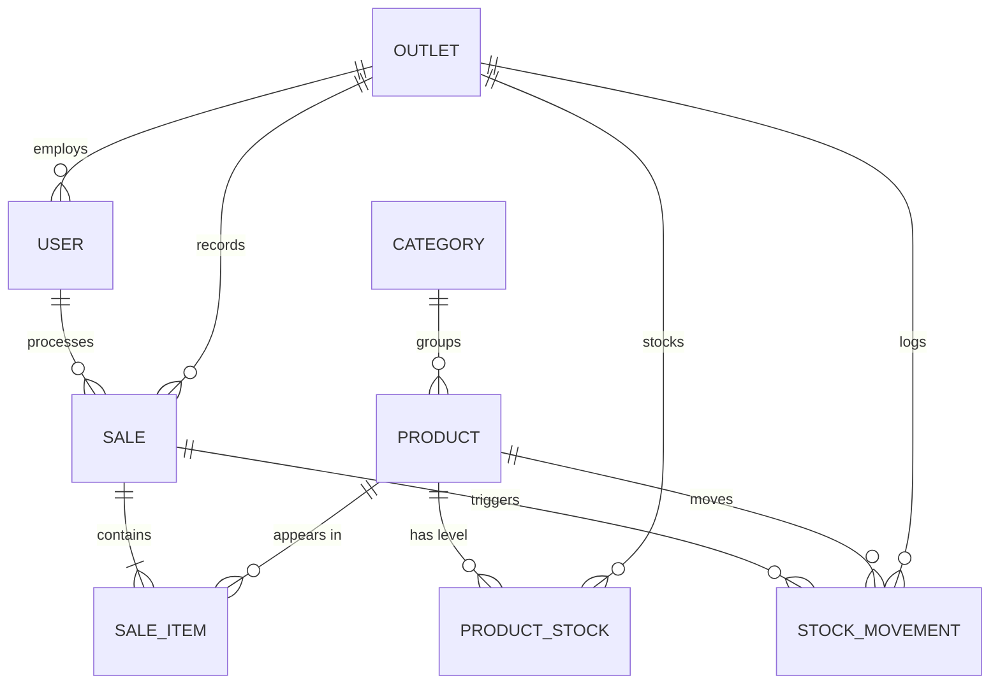

# Database Design

**Project:** POS System Backend
**Database:** MongoDB 7 (Mongoose)
**Last updated:** 2026-10-05

## 1. Entity Relationship Diagram

## 2. Collections

### 2.1 `outlets`

| Field | Type | Notes |
|-------|------|-------|
| _id | ObjectId | PK |
| name | string | required, unique |
| code | string | required, unique, short code |
| address | string | optional |
| phone | string | optional |
| isActive | boolean | default true |
| createdAt / updatedAt | Date | timestamps |

Indexes: `code` unique, `name` unique.

### 2.2 `users`

| Field | Type | Notes |
|-------|------|-------|
| _id | ObjectId | PK |
| name | string | required |
| email | string | required, unique, lowercase |
| passwordHash | string | required, `select: false` |
| role | enum | `ADMIN` \| `CASHIER`, default `CASHIER` |
| outletId | ObjectId | ref `outlets`, required for `CASHIER` |
| isActive | boolean | default true |
| refreshTokenHash | string | `select: false`; bcrypt hash of the active refresh token |
| createdAt / updatedAt | Date | timestamps |

Indexes: `email` unique, `outletId`.

> Implemented: `outletId`, `isActive`, and `refreshTokenHash` on the schema.
> `refreshTokenHash` stores one active refresh token per user; login and
> refresh rotate it, logout clears it.

### 2.3 `categories`

| Field | Type | Notes |
|-------|------|-------|
| _id | ObjectId | PK |
| name | string | required, unique |
| description | string | optional |
| createdAt / updatedAt | Date | timestamps |

Indexes: `name` unique.

### 2.4 `products`

| Field | Type | Notes |
|-------|------|-------|
| _id | ObjectId | PK |
| title | string | required |
| sku | string | required, unique |
| price | number | required, min 0 |
| cost | number | optional, min 0 |
| unit | string | optional, e.g. `pcs` |
| categoryId | ObjectId | ref `categories` |
| imageFileId | ObjectId | ref GridFS file |
| isActive | boolean | default true |
| createdAt / updatedAt | Date | timestamps |

Indexes: `sku` unique, `categoryId`, text index on `title`.

> Implemented: `sku` (unique sparse), `cost`, `unit`, `isActive` added. Field
> `category` (ObjectId ref `categories`) is used instead of `categoryId`.

### 2.5 `product_stocks`

Stock level is per product per outlet.

| Field | Type | Notes |
|-------|------|-------|
| _id | ObjectId | PK |
| productId | ObjectId | ref `products`, required |
| outletId | ObjectId | ref `outlets`, required |
| quantity | number | required, min 0, default 0 |
| updatedAt | Date | timestamps |

Indexes: compound unique `{ productId, outletId }`.

> Alternative: embed `stock` on `products` for single-outlet. Kept separate to
> satisfy multi-outlet stock isolation.

### 2.6 `stock_movements`

Append-only ledger.

| Field | Type | Notes |
|-------|------|-------|
| _id | ObjectId | PK |
| productId | ObjectId | ref `products`, required |
| outletId | ObjectId | ref `outlets`, required |
| type | enum | `STOCK_IN` \| `STOCK_OUT` \| `SALE` \| `ADJUSTMENT` |
| quantity | number | required, signed or positive + type |
| reason | string | optional |
| saleId | ObjectId | ref `sales`, set for `SALE` |
| userId | ObjectId | ref `users`, actor |
| createdAt / updatedAt | Date | timestamps |

Indexes: `{ productId, outletId, createdAt }`, `type`, `saleId`.

### 2.7 `sales`

| Field | Type | Notes |
|-------|------|-------|
| _id | ObjectId | PK |
| invoiceNumber | string | required, unique, human-readable |
| outletId | ObjectId | ref `outlets`, required |
| cashierId | ObjectId | ref `users`, required |
| subtotal | number | required |
| discount | number | default 0 |
| total | number | required |
| paymentMethod | enum | `CASH` \| `QRIS` \| `CARD` \| `TRANSFER` |
| amountPaid | number | required |
| change | number | required for `CASH`, else 0 |
| status | enum | `COMPLETED` \| `VOID` \| `REFUNDED` |
| customerEmail | string | optional, for receipt |
| createdAt / updatedAt | Date | timestamps |

Indexes: `invoiceNumber` unique, `{ outletId, createdAt }`, `cashierId`.

### 2.8 `sale_items`

| Field | Type | Notes |
|-------|------|-------|
| _id | ObjectId | PK |
| saleId | ObjectId | ref `sales`, required |
| productId | ObjectId | ref `products`, required |
| titleSnapshot | string | product name at sale time |
| priceSnapshot | number | unit price at sale time |
| quantity | number | required, min 1 |
| lineTotal | number | price * quantity |
| createdAt | Date | timestamp |

Indexes: `saleId`, `productId`.

### 2.9 `audit_logs` (existing)

| Field | Type | Notes |
|-------|------|-------|
| _id | ObjectId | PK |
| method | string | HTTP method |
| url | string | request URL |
| statusCode | number | response status |
| responseTimeMs | number | latency |
| ipAddress | string | client IP |
| userAgent | string | optional |
| userId | string | optional |
| userEmail | string | optional |
| userRole | string | optional |
| createdAt / updatedAt | Date | timestamps |

Indexes (recommended): `createdAt`, `userId`.

### 2.10 GridFS `document.*` (files, existing)

Managed by `FilesService` via GridFSBucket `document`. Stores receipt images,
product images, and exported reports. Metadata: `contentType`, `filename`.

## 3. Relationships Summary

- Outlet 1---* User, ProductStock, Sale, StockMovement.
- Product 1---* ProductStock, SaleItem, StockMovement.
- Category 1---* Product.
- Sale 1---* SaleItem.
- User 1---* Sale (cashier) and StockMovement (actor).

## 4. Design Notes

- Sales and movements are append-only; correct mistakes with void/adjustment,
  never delete.
- `product_stocks` is the source of truth for current quantity; movements are
  the audit trail. A nightly reconciliation job can rebuild stock from
  movements.
- Prefer storing snapshot fields (`titleSnapshot`, `priceSnapshot`) so historic
  receipts stay correct after product edits.
